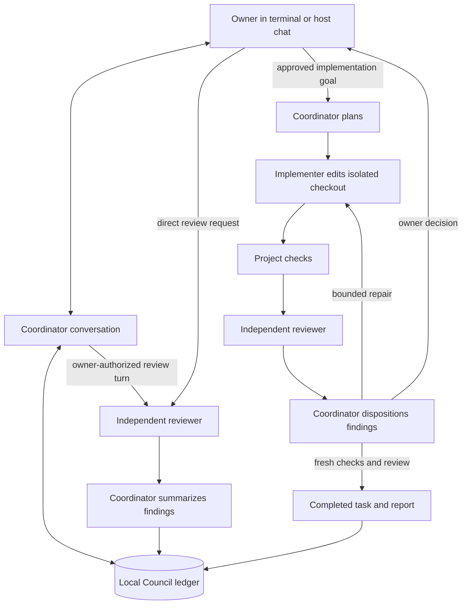
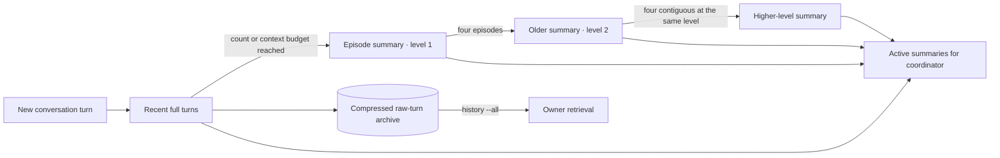

# Council

A reusable local toolkit for a coordinator conversation, independent review, implementation, checks, repair, and owner decisions. Roles, models, workflows, and project rules are configuration. It keeps task and conversation state in one local ledger rather than generating prompt files.



The coordinator can answer questions and plan with you without launching implementation. An explicit request to review existing code or a plan, paired with `--allow-review` on that chat turn, dispatches a read-only reviewer; that path needs no implementer output or configured checks. Remote device pairing and messaging gateways are separate integrations: installing this toolkit does not connect a phone or create a bot.

## Start here

Use Python 3.11 or newer. The source launcher looks for a suitable Python if the system `python3` is older. The core needs no third-party Python packages. To install the release as a command available from any directory, clone the public repository and use [pipx](https://pipx.pypa.io/stable/installation/):

```sh
git clone https://github.com/rsr215/council-toolkit.git
cd council-toolkit
pipx install .
council --version
```

If pipx is unavailable, install into a Python 3.11+ virtual environment and activate that environment before using `council`. The project's ledger, rosters and registered-project configuration live in your user data directory, outside this clone. `council --version` prints the installed release version.

`pipx install` installs the CLI only. If you use Codex and want the optional companion skill, install it separately from the clone:

```sh
mkdir -p ~/.codex/skills/council
cp skills/council/SKILL.md ~/.codex/skills/council/SKILL.md
```

Use `$CODEX_HOME/skills/council` instead if your Codex home differs. VS Code Copilot Chat does not load Codex skills; its agent can call the `council` command through the terminal when your work environment permits it.

```sh
./bin/council demo
./bin/council doctor --auth
```

The demo uses simulated agents in a temporary directory, exercises automatic completion, a repair and an owner decision, and removes its files afterward. It uses no account or API. Once installed on PATH, the entry point is `council`. A wheel includes the bundled roster; the first `council assign` copies it to your personal Council home for editing.

The companion Codex skill supports **“Run the council on this task.”** The host agent handles commands, worktrees, and decision IDs; you give the objective and answer decisions in ordinary language.

Register each project once:

```sh
council init /path/to/project --name my-project
council doctor my-project --auth
council chat my-project "Let's plan the export feature"
council chat my-project "Ask the reviewer to inspect the current design" --allow-review
council review my-project "Review the current design and implementation risks"
council run my-project "Implement the approved export feature" --workspace /path/to/isolated-checkout
council status
council summary TASK_ID
council report TASK_ID
```

After `init`, fill in the generated project configuration with its actual rules, checks for delivery, and protected paths. It lives under `~/.local/share/llm-council/projects/`, outside the project. Use `--files` for a non-Git project and configure explicit `include` patterns.

Workflows that edit files require an explicitly selected alternate workspace unless you deliberately set `allow_in_place = true`. Use the coding agent's worktree tools to create/reuse a checkout. Read-only workflows can use the registered project directly. One worker runs at a time per ledger.

`chat` stores a per-project conversation and layered memory in the ledger. Concurrent turns on the same conversation are refused until the first finishes, preserving memory order. Repeat `council chat PROJECT "message"` for another turn, omit the message for an interactive terminal (type `/review scope` there for an explicitly authorized review), or use `--history` to read prior turns without a model call. A coordinator reply can launch only the read-only review workflow when you explicitly request it and use `--allow-review`; implementation still uses `run`. `review` runs reviewer → coordinator summary on existing material without changing the project. `run` executes delivery until completion, an owner checkpoint, failure, or budget exhaustion. `run --plan-only` and `review --plan-only` queue without model calls. `--json` on these commands exposes state to integrations; progress goes to stderr.

## Command reference

Global options go before the command: `--home PATH` selects the ledger and project registry (default `COUNCIL_HOME`, else `~/.local/share/llm-council`), and `--roster PATH` overrides the roster for that call. `council --version` prints the release version. `council --help` and `council COMMAND --help` list every flag. `PROJECT` is a registered name or a project TOML path.

**Projects and setup**

| Command | What it does | Example and key flags |
| --- | --- | --- |
| `init` | Registers a project without changing its files | `council init ~/code/app --name app`; `--files` for a non-Git project, `--workflow delivery\|research\|review` |
| `doctor` | Checks configuration, executables, the selected roster and the coordinator's chat session mode, without model calls | `council doctor app --auth`; `--auth` queries Codex/Claude sign-in and prints manual validation guidance for Copilot/Gemini |
| `assign` | Changes a role's executor, model and effort for new runs; other role settings such as `chat_session` are kept | `council assign reviewer --project app --executor codex --model MODEL_ID --effort high`; omitting `--effort` keeps it for the same executor |
| `import-context` | Saves historical Markdown handoffs and a reconciled summary; launches nothing | `council import-context app ./handoffs --summary summary.md` |
| `context` | Reads the imported context or one archived source | `council context app --source coordinator/HANDOVER.md`; `--json` |
| `demo` | Runs a simulated council in a temporary directory; no accounts or API calls | `council demo` |

**Conversation**

| Command | What it does | Example and key flags |
| --- | --- | --- |
| `chat` | Talks with the read-only coordinator; omit the message for an interactive terminal | `council chat app "Plan the export feature"`; `--thread NAME`, `--allow-review` lets this turn dispatch a reviewer, `--new-session` starts a fresh native session and keeps history, `--history` (add `--all` for archived turns) reads without a model call, `--json` |
| `compact` | Catches up conversation summaries without starting a task | `council compact app --max-steps 20`; `--thread`, `--dry-run` shows whether compaction is due without a model call, `--json` |

**Tasks**

| Command | What it does | Example and key flags |
| --- | --- | --- |
| `review` | Independently reviews existing material, then the coordinator summarizes; changes nothing | `council review app "Review the current design"`; `--workspace PATH`, `--plan-only`, `--json` |
| `run` | Starts an approved objective with the project's workflow | `council run app "Implement the export" --workspace ../app-wt`; `--workflow PATH`, `--plan-only` queues without model calls, `--json` |
| `status` | Lists active work, or one task with any pending decision and its request ID | `council status` or `council status TASK_ID`; `--json` |
| `summary` | Shows a task's compact briefing | `council summary TASK_ID`; `--json` |
| `report` | Prints the detailed evidence saved for each phase | `council report TASK_ID --phase review` |
| `work` | Continues a queued or resumed task to the next owner checkpoint | `council work TASK_ID`; `--json` |
| `decide` | Answers a pending owner decision | `council decide TASK_ID respond --request REQUEST_ID --note "Use option A" --continue`; choices come from `status` (`respond` needs `--note`), `--continue` resumes work |
| `pause` | Pauses a task and stops its active subprocess | `council pause TASK_ID` |
| `cancel` | Cancels a task; existing edits are kept | `council cancel TASK_ID` |
| `resume` | Re-enables an interrupted or paused task after you inspect it | `council resume TASK_ID --note "Inspected partial changes"`; `--note` is required |
| `gc` | Previews, then compacts, closed task reports past retention; decision receipts stay | `council gc`, then `council gc --apply`; `--days N` overrides each project's retention |

## Assign models without changing code

The bundled `council/roster.toml` is the example roster. Models do not appear as defaults in Python.

```toml
[executors.primary]
kind = "claude-cli"
binary = "claude"

[workflow_roles.coordinator]
executor = "primary"
model = "opus"
```

```sh
council assign coordinator --executor codex --model MODEL_ID --effort high
```

The model identifier passes unchanged to its runtime. Unavailable workflow models never silently fall back. Each run saves its starting roster/workflow; edits affect new runs. Provider aliases can resolve differently over time; choose an exact supported ID when necessary.

| Executor | Operation |
| --- | --- |
| `codex-cli` | Installed CLI, fresh ephemeral session, JSON schema, read-only/workspace-write sandbox |
| `claude-cli` | Installed CLI, fresh session for every workflow phase, auto-memory off, JSON schema, restricted read tools for snapshot roles; coordinator chat can resume a native session when the roster opts in (see [State and sessions](#state-and-sessions)) |
| `antigravity-cli` | Gemini through Google’s supported CLI, read-only research |
| `copilot-cli` | GitHub Copilot CLI, explicit model and effort, limited file tools for each phase; requires an allowed CLI account |
| `command` | Explicitly trusted adapter: prompt on stdin, JSON on stdout; no shell interpolation or Council sandbox |

The bundled roster assigns Claude Opus 5.5 to coordination and implementation, GPT-6 Sol to independent review, and Gemini 3.1 Pro through Antigravity to optional research. These are examples, not engine defaults. Each role has an explicit `high` effort setting; unsupported model/effort combinations fail rather than silently falling back. CLI workflows use each provider CLI's own sign-in. The Gemini researcher still needs a live account/model check on the host.

To use your work Copilot entitlement when policy permits, change role assignments in a **separate project roster** for your work projects (see below), for example `council assign reviewer --project work-app --executor copilot --model gpt-6-sol --effort high`. The installed Copilot CLI must expose that model to your work account. A VS Code Copilot model picker alone does not prove CLI access. The runtime permits only file tools needed by the phase and expects strict JSON output; it has unit coverage but no live work-account test. [GitHub's CLI reference](https://docs.github.com/en/copilot/reference/copilot-cli-reference/cli-command-reference) documents model and effort flags.

A custom `command` adapter is an escape hatch for a runtime Council does not know. It runs with your host account's permissions and is **not** a read-only security boundary. Configure `trusted = true` only for an adapter you control and isolate sensitive projects separately. Council never substitutes a configured model or executor silently.

### Choose a roster per project

For `doctor PROJECT`, `chat`, `compact`, `run` and `review`, Council uses the first of:

1. `--roster PATH`
2. `COUNCIL_ROSTER`
3. `roster = "..."` in the project TOML
4. `COUNCIL_HOME/roster.toml` (your personal roster)
5. the bundled roster

A relative project `roster` path resolves against the project TOML's folder, never the current directory. `council doctor PROJECT` prints the selected roster and its source. If a project declares a roster that does not exist, these commands stop with its path rather than using another roster; `--roster` or `COUNCIL_ROSTER` still override it. `chat --history` and `compact --dry-run` need no roster.

To give a project its own models:

```sh
council doctor my-project                  # shows "Roster: PATH (source)"; copy that file to start
# in ~/.local/share/llm-council/projects/my-project.toml:
#   roster = "my-project.roster.toml"
council assign reviewer --project my-project --executor copilot --model MODEL_ID --effort high
```

`assign --project` edits only the roster file that project declares; it never edits the project TOML. If the declared file does not exist yet, it first copies your personal roster (or the bundled one) there. It refuses when the project declares no roster, or when the declared file (after following symlinks and `..`, or through a hard link) is the bundled roster, your personal roster, the `COUNCIL_ROSTER` file or another registered project's roster; to edit a shared file on purpose, use `council --roster PATH assign ...`. Without `--project`, the first `council assign` copies the bundled roster into `COUNCIL_HOME` and edits that personal copy. Every task saves its roster when created, so queued and existing tasks, including `work` and `resume`, keep their assignment after the roster is edited or deleted. `COUNCIL_HOME` or `--home` selects the ledger and project registry.

## State and sessions

The authoritative task state is a local SQLite ledger under `COUNCIL_HOME` (default `~/.local/share/llm-council`). Any chat or terminal on the same host with permission to run the CLI can inspect it with `council status`, `council summary TASK_ID`, and `council report TASK_ID`. The chat itself is an interface, not the storage layer. Another machine sees no state until you deliberately move or host the ledger; do not sync a live SQLite database through Git.

Every workflow phase, reviewer, implementer and conversation summary starts a fresh model session: Codex uses `--ephemeral`, Claude uses `--no-session-persistence`, and Antigravity is invoked without a resume ID. Only coordinator chat can reuse a session, as described below. Council passes the current objective, selected earlier phase outputs, owner decisions, and a workspace fingerprint. The coordinator also receives the imported project summary, if present. Archived source documents are stored for retrieval but are not automatically sent to models. New tasks do not automatically inherit all reports from earlier tasks or a vendor chat transcript. This makes reviewers more independent and limits stale conversation context, but can repeat input tokens; no token-saving claim has been benchmarked.



A fresh coordinator turn carries recent full turns (up to 32 and a 32,000-character budget), all active older summaries (up to 10,000 characters), working memory, imported project summary, and recent task outcomes. If the summaries exceed that budget, Council merges older contiguous spans before answering; if it cannot catch up within four calls, it asks you to run `council compact`. You can inspect them with `council chat PROJECT --history`, or retrieve archived full turns with `council chat PROJECT --history --all`. This is portable across host chats on the same computer; it does not copy a vendor's full session or sync the ledger to another machine. Working memory and historical summaries are model-authored aids, not sources of owner approval or verified evidence.

### Native coordinator chat sessions

A coordinator role can set `chat_session = "native"` (the bundled roster does) and optionally `chat_session_turns` (1-100, default 20). Each project thread then keeps one Claude CLI session across `council chat` turns. The first turn sends the full ledger packet with `--session-id`. Later turns use `--resume` and send only the owner message, current working memory, recent task outcomes, the workspace revision and the read-only authority instructions. A turn runs in a fixed per-thread directory under `COUNCIL_HOME/chat-cwd/`, because the CLI finds sessions by working directory. Council rebuilds the snapshot there for each turn and deletes it afterwards. Restricted read tools, empty MCP configuration and disabled auto-memory apply on every turn. Missing the setting, or `chat_session = "ledger"`, keeps the fresh-session behaviour above. Only `claude-cli` supports native sessions. On Codex, Copilot, Antigravity or a command adapter, `native` falls back to ledger context, and `council doctor` reports the fallback.

The ledger stays authoritative. Council resumes a session only if every one of these holds:

- the previous turn committed;
- the session has seen the newest ledger turn in the thread;
- the session has run fewer than `chat_session_turns` turns;
- the session's previous committed turn reported fewer than `chat_session_context_tokens` input and cache tokens, or reported no usage (see below);
- no compaction has run since the session's last turn, whether automatic or through `council compact`;
- `--new-session` was not given;
- the executor kind, binary, model, effort, project rules, imported summary and workspace path are unchanged.

Otherwise it starts a fresh native session with the full ledger packet. When files changed but the path did not, the session resumes with `workspace_changed: true` and an instruction to re-read files. A failed resume (non-zero exit or provider error, for example a deleted session) is retried once as a fresh session in the same turn. Timeouts, pause/cancel and output limits are never retried. `council chat PROJECT --new-session "message"` starts a fresh session and keeps the ledger history. In an interactive chat, the flag applies to the first turn. `--history` shows the session state, the reason the current session started, and the latest turn's mode and measurements. `--history --json` includes per-turn metrics: mode (`native-fresh`, `native-resume` or `ledger`), Council-measured wall time, and the provider-reported tokens, cache tokens and cost. Values the provider did not report are `null`.

`chat_session_context_tokens` (an integer from 1,000 to 2,000,000, default 100,000) sets when a session's context counts as too large to resume. Before each turn, Council adds up the provider-reported `input_tokens`, `cache_read_tokens` and `cache_creation_tokens` recorded for the session's previous committed turn. If the total is at least the threshold, Council starts a fresh session and records `provider context usage reached chat_session_context_tokens (N >= T)` as the rotation reason. Any other value, including a boolean, a decimal or a quoted number, makes `council chat`, `council doctor` and roster loading fail. Limitations:

- The check uses the previous turn's figure, so the turn that crosses the threshold still resumes. Only the turn after it starts fresh.
- The Claude CLI reports usage summed over the whole turn. A turn with several tool calls can therefore report more than the actual context size, so this rotation is conservative and approximate. It does not measure the context window exactly.
- Output tokens are not counted.
- If the provider reported none of the three figures (`null`), only `chat_session_turns` and the other conditions above apply. If it reported some of them, Council adds up the ones it has.
- `chat_session_turns` always applies as a hard cap, even when usage is reported.

With native sessions the provider keeps transcripts, including file contents the coordinator read, in its own local storage (for Claude, under its configuration directory). That storage is outside Council's ledger, `gc` and retention. `--new-session` drops only Council's binding; it does not delete provider transcripts. Set `chat_session = "ledger"` if you do not want provider-side transcripts. No token or latency savings have been measured for this toolkit. `python3.11 tests/live_smoke.py coordinator-session` runs three ledger turns and three native turns against the live CLI and prints the measured rows.

### Use Council at work with GitHub Copilot

Install the toolkit as above on your work machine, then check that your organization permits [Copilot CLI](https://docs.github.com/en/copilot/how-tos/copilot-cli/set-up-copilot-cli/install-copilot-cli) and sign in with `copilot login`. VS Code Copilot Chat alone does not expose its models to Council; Council invokes the separate CLI. Keep your work project's roster separate from your personal roster:

```sh
council init /path/to/work-project --name work-app
# In the project TOML printed by init, uncomment or add:
# roster = "work-app.roster.toml"
council assign coordinator --project work-app --executor copilot --model COORDINATOR_MODEL --effort high
council assign implementer --project work-app --executor copilot --model IMPLEMENTER_MODEL --effort high
council assign reviewer --project work-app --executor copilot --model REVIEWER_MODEL --effort high
council doctor work-app --auth
```

For Copilot, `doctor --auth` checks that the CLI is installed and reminds you to validate sign-in and model access; it does not confirm them. Run `copilot login` and a small CLI prompt under your work account before using Council for work tasks.

Choose model IDs your work account actually offers; [Copilot CLI documents model selection](https://docs.github.com/en/copilot/reference/copilot-cli-reference/cli-command-reference). You can assign a researcher the same way if your workflow uses one. Set the project's rules, checks and protected paths in its TOML before `council run`. The Copilot CLI adapter has unit coverage but has not been live-tested with your work account; validate a small, non-sensitive task on that machine first. Your work project's ledger and configuration stay on that machine unless you explicitly move them.

GitHub Copilot Chat in VS Code can act as a controller if its agent may run the local `council` CLI. To use models from your Copilot plan as Council roles, install and authenticate [Copilot CLI](https://docs.github.com/en/copilot/how-tos/copilot-cli/automate-copilot-cli/run-cli-programmatically), confirm your organization permits it, then assign roles to the configured `copilot` executor. Council passes the selected model and effort and restricts each phase to file tools; the adapter has unit coverage but has not been live-tested on a work account. Models visible in VS Code are not automatically available to a separate CLI. Do not send company code to personal provider accounts without authorization.

## Decisions and recovery

`status` shows the pending question, choices and request ID. In chat, the coding agent presents the evidence and records your answer.

```sh
council decide TASK_ID respond --request REQUEST_ID --note "Use option A; preserve the interface" --continue
council pause TASK_ID
council cancel TASK_ID
```

Owner decisions are bound to the workspace fingerprint. Duplicate or stale responses are rejected. A completed Council task does **not** merge, publish, deploy or purchase anything.

Delivery requires current passing checks and an independent review before automatic completion; the completion route enforces fresh evidence. The coordinator cannot override a failed check by returning “ready.” It dispositions findings with evidence or asks the owner. Delivery permits three implementation passes (two repair attempts) and fourteen executed phases. Other workflows set their own bounds.

After an interruption, inspect partial changes and any surviving CLI process before resuming:

```sh
council resume TASK_ID --note "Inspected changes and confirmed the old process stopped"
council work TASK_ID
```

If the computer stops during a phase, its last committed state may still say `running`. The next `council work TASK_ID` marks that phase `interrupted` without replaying it. Inspect partial edits and any surviving process, then use `resume` and `work` as above. If a phase finished and its result was committed before shutdown, `work` can continue from the saved next phase. Changed files invalidate old reviews and restart validation at the entry phase without resetting budgets. A still-valid pending gate is restored instead. Pause/cancel terminates the active subprocess group when the worker observes it; existing edits are preserved. SIGTERM also attempts to stop the subprocess group and remove temporary files; a hard power loss or SIGKILL cannot run that cleanup. After a shutdown during coordinator chat, inspect `council chat PROJECT --history` before resending; compaction occurs before the reply, but a turn committed just before shutdown may already be present. A native chat session is marked pending before each provider call and cleared only in the same transaction that records the turn. After a crash, Ctrl-C, SIGTERM, provider failure, invalid reply, refused review or workspace change, the next turn starts a fresh session from the ledger instead of resuming a reply the ledger never recorded.

## Project and workflow configuration

The project owns requirements and verification; the toolkit owns sequencing.

```toml
version = 1
name = "example"
workspace = "/path/to/project"
git = true
workflow = "/path/to/workflow.toml"
roster = "example.roster.toml"   # optional; relative to this file
allow_in_place = false
timeout_seconds = 900
retention_days = 30
max_snapshot_bytes = 100000000
protected_paths = ["docs/architecture.md", "docs/decisions/*"]
checks = [["python3", "-m", "unittest", "discover", "-s", "tests"]]
rules = "The owner decides scope and architecture. Preserve approved interfaces."
```

Project paths can be relative to the configuration file. Check commands are argument arrays, not shell strings; these are trusted project commands. Empty checks never count as passing verification. A project without executable checks needs a workflow without a check phase.

No `AGENTS.md`, `CLAUDE.md`, skill, `CONTRIBUTING.md`, or other Markdown file is required. Project rules live in the generated project TOML; existing documents can be included as evidence. For non-Git work, use `git = false` and set explicit `include` patterns for the files you approve. Git projects snapshot tracked and unignored files. Snapshots exclude `.git`, `.council`, `.env*`, and Python caches, reject symlinks/submodules, and enforce a size bound. Keep private files outside project inputs.

Workflows are TOML phase graphs with arbitrary role names and three phase kinds: `agent`, `check`, `human`. See [delivery](council/workflows/delivery.toml), [review](council/workflows/review.toml), and [research](council/workflows/research.toml). Research synthesizes supplied material and finishes with a summary unless it needs a decision; it does not imply live web research. Editorial, planning and analysis workflows can have different phases/roles without engine changes.

Agent phases define `role`, `instructions`, `read_only`, `inputs`, and allowed outcome `routes`. `needs_owner` pauses. `fresh_inputs` and `required_outcomes` enforce evidence requirements. Human routes go to another phase or `@done`.

A command adapter receives a complete prompt and returns exactly:

```json
{"outcome":"ready","summary":"Concise outcome","report":"Full findings or evidence","question":""}
```

Allowed outcomes come from the supplied schema. Return `needs_owner` with an actionable question to pause. An adapter's `argv` can use whole arguments `{model}`, `{schema}`, `{output}`; these are substituted without shell evaluation. Custom adapters require their own permission controls.

## Storage and cleanup

Task state, coordinator conversation, bounded reports, events and decisions live in **one SQLite ledger** outside project directories. Handoffs generate no dated files. Before answering a new chat turn, Council compacts when 31 unarchived turns have accumulated or older raw turns no longer fit the recent-context budget. It summarizes the oldest available batch (up to 24 turns and 48,000 source characters); four contiguous summaries at the same level are later merged into a higher-level summary. Normal conversations need roughly one summary call per batch. Council makes at most four automatic calls before a turn; if a migrated or unusually large backlog still leaves a context gap, it refuses to answer and tells you to run `council compact PROJECT --thread THREAD`. The raw turns are compressed into the ledger, and archive, summary and removal from the recent-turn table commit atomically. If the model or transaction fails, the raw turns remain and no owner reply is recorded. Compaction is triggered by accumulated turns and context size, not days. Temporary snapshots and adapter files are removed after each call. Provider-owned diagnostics, caches and native chat transcripts remain outside toolkit cleanup.

After workflow execution, **closed task reports** older than the project's retention period (30 days by default) are compacted separately. Their phase summaries, configuration provenance and decision receipts remain. Unresolved/interrupted work is preserved. Compressed conversation archives still use disk space; the ledger's 256 MB threshold stops new task runs until storage is inspected. Council requires its home directory to be private (`chmod 700`) and restricts SQLite files to `600`.

```sh
council gc                         # preview expired closed task reports
council gc --apply                 # compact those reports
council compact PROJECT --dry-run  # inspect conversation compaction due
council compact PROJECT --max-steps 20  # catch up a long conversation
```

Cleanup never deletes project outputs, old `.council` mailboxes, or worktrees. Use managed worktree archival when a checkout is no longer needed. Compact records still use space; retention does not promise zero database growth.

## Remote use: recommended first setup

Start with **Codex Remote** as the interface to the local toolkit. It supports steering work, approvals, results, and completion/attention notifications from the ChatGPT mobile app, subject to account/workspace availability. Pair your phone in desktop Settings → Connections → Control this Mac/PC, then use Remote on the phone. Keep the computer awake, online, and the app running. See the [official guide](https://learn.chatgpt.com/docs/remote-connections).

Monitoring is active only during unattended work. The companion skill enables the existing host heartbeat at dispatch and pauses it when no jobs are ready/running; the heartbeat self-pauses too. Waiting decisions need an owner reply, not repeated model wakeups. Direct CLI runs do not control the app scheduler. No event-push service is installed.

The companion skill lets the host chat operate the toolkit. The CLI is not a background daemon and sends no push notifications itself. A supervising chat or supported scheduled follow-up must actually run and observe the task for host notifications. Pending decision state persists without a worker; the owner's answer and continuation start work again.

**OpenClaw** is an optional next interface if you prefer Telegram, Slack or other messaging. It offers a [self-hosted gateway](https://docs.openclaw.ai/), [external agent runtimes](https://docs.openclaw.ai/tools/acp-agents), and [durable task flows](https://docs.openclaw.ai/automation/taskflow). An integration should call the toolkit's structured commands, authenticate the owner, bind replies to request IDs, and notify only for decisions, failure and completion. Keep one authoritative ledger rather than competing workflow controllers. No OpenClaw integration is installed here.

**NemoClaw** adds deployment/runtime policy controls around systems including OpenClaw. It becomes useful for dedicated hosting and stronger isolation; it is not needed for the initial council. See [NVIDIA's overview](https://www.nvidia.com/en-us/ai/nemoclaw/).

For work while a laptop is asleep, run the worker and authenticated CLIs on an always-on host. A remote interface does not supply that compute.

## Boundaries and validation

- This is a single-owner local tool, not an authenticated multi-user service. Remote adapters must authenticate the owner; never expose arbitrary CLI execution publicly.
- Fresh snapshot/context separation reduces reviewer contamination, but is not a complete OS security boundary. Read-only sandboxes may allow broader reads. Sensitive workloads require stronger isolation.
- Protected-path checks pause after local edits and before downstream work; they do not prevent an attempted edit. Semantic architecture decisions still require agent escalation and review.
- The runner bounds steps, time and output, not cross-provider dollars. It does not promise exactly-once external side effects after crashes.
- Deliverables stay in the checkout. Publishing, PR creation/merging and checkout archival remain explicit host operations.

```sh
python3.11 -m unittest discover -s tests -v
./bin/council demo
```

Tests use real temporary subprocesses and simulated adapters. `tests/live_smoke.py coordinator` or `implementer` is an opt-in live CLI check with a 120-second timeout; `coordinator-session` makes six live chat calls and prints their measured wall time and usage. Authentication checks do not call a model; smoke checks do.

## Continue an existing project

Import a local Markdown handoff directory with a reconciled summary:

```sh
council import-context PROJECT /path/to/handoffs --summary /path/to/summary.md
council context PROJECT
council context PROJECT --source coordinator/HANDOVER.md
```

The import saves exact source text, checksums, timestamps and provenance in one project record in the central ledger. It neither launches tasks nor records old claims as new checks or approvals. Reimporting unchanged content is idempotent; a changed import replaces the project's current context record. Originals are untouched. New tasks freeze the summary and revision; existing tasks retain their original context. Only workflow phases with `include_project_context = true` receive that summary (the coordinator in the bundled workflows). Reviewers do not receive the historical coordinator summary or raw mailbox; applicable requirements must be in their explicit task/project rules.

Keep the summary concise, distinguish historical reports from freshly checked facts, list unresolved decisions, and reference the source paths. Source imports are bounded to 500 Markdown documents / 8 MB; summaries to 32 KB. This feature owns migration evidence; current specifications remain in the project repository. No per-prompt project files are generated.

## License

MIT; see [LICENSE](LICENSE).
